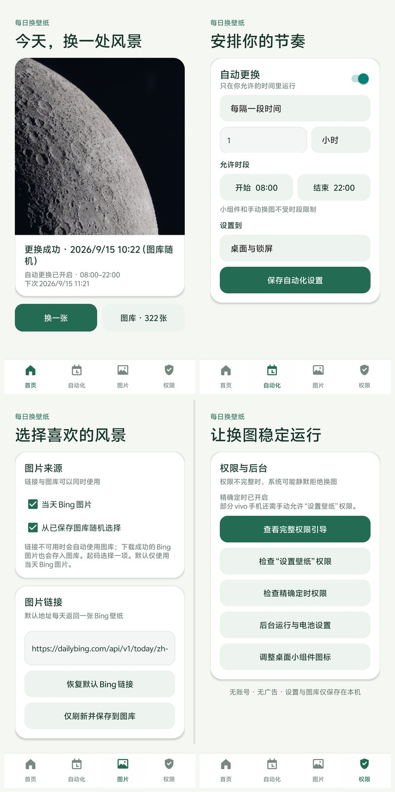

<p align="center">
  
</p>

<h1 align="center">每日换壁纸</h1>

<p align="center">一个轻量的原生 Android 壁纸应用，可定时使用当天的 Bing 图片或本地图库更换桌面与锁屏壁纸。</p>

<p align="center">
  
  
  
</p>

[官方网站](https://dunn.fun/daily-wallpaper/)

首次打开会依次引导设置壁纸、精确定时和后台运行权限。首页以当前壁纸和“一键换图”为核心，壁纸预览会随手机屏幕高度伸展，并在平板上居中限制宽高；自动化、图片来源、链接及权限整理为独立卡片，权限引导也可随时重新打开。桌面启动图标采用浅鼠尾草绿的双相片循环设计。

<p align="center">
  
</p>

## 功能

- 使用当天的 Bing 壁纸，也可填写其他图片直链
- 导入本地文件夹，随机使用已保存图片
- 支持每天固定时间或按分钟、小时、天循环更换
- 可设置自动更换允许时段，默认 `08:00–22:00`，避免夜间换图
- 提供 `1×1`、`1×2`、`2×4`、`2×5` 桌面小组件
- 链接不可用时自动改用本地图库
- 无账号、无广告、无第三方运行库

支持 Android 7.0 及以上系统。

## 下载

请从 [Releases](https://github.com/xudong7587/daily-wallpaper-android/releases/latest) 下载最新版 APK。覆盖安装可以保留原有设置和应用内图库，请勿先卸载旧版。

首次使用建议：

1. 打开应用并选择图片来源、目标壁纸和自动更换方式。
2. 点击“立即更换一次”确认效果。
3. 开启自动更换，并授予精确定时、后台运行和自启动权限。
4. vivo 等部分手机还需在应用的“所有权限／其他权限”中允许“设置壁纸”。

Android 的省电和后台限制可能使定时任务稍有延迟。桌面小组件和“立即更换一次”不受允许时段限制。

## 图片来源

- 只选链接：使用当前链接图片，默认是当天 Bing 图片，并保存到应用图库。
- 只选图库：从已保存图片中随机选择，不访问网络。
- 两项都选：先下载链接图片，再与历史图片和本地导入图片一起随机选择。

链接下载失败时，只要图库不为空，应用会自动使用本地图片。图片按内容去重。卸载应用或清除应用数据会删除应用内图库，重要图片请先导出。

## 构建

项目使用 Java，最低 Android API 24，目标 API 35。可用 Android Studio 打开，也可在 PowerShell 中运行：

```powershell
.\test.ps1
.\build.ps1 `
  -Jdk 'C:\path\to\jdk17' `
  -BuildTools 'C:\path\to\android-sdk\build-tools\35.0.0' `
  -PlatformJar 'C:\path\to\android-sdk\platforms\android-35\android.jar'
```

构建产物位于 `dist/DailyWallpaper.apk`。`build.ps1` 会生成本地测试签名；正式分发时请改用自己的签名并妥善保管密钥。

## 验证

项目包含每日时间、间隔时间、允许时段、图库去重、断网回退、壁纸结果确认和小组件布局测试。当前版本已在 vivo V2454DA / Android 16 上验证小组件和定时换图。

## 隐私

设置和图库仅保存在设备本地。网络请求只用于下载用户配置的图片链接，应用不会上传图片或个人数据。
